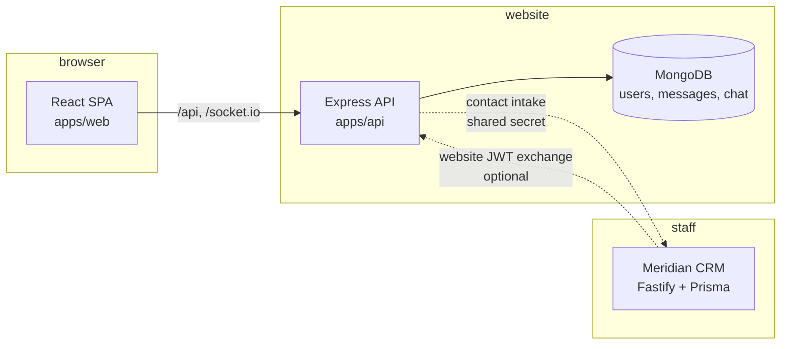

# Architecture

## Shape

Two deployables in one repository, with an optional HTTP bridge to the CRM.

The browser never talks to the CRM directly in normal operation. The API is the only website
process with database credentials or email credentials. The CRM is a separate deployment with its
own database, release cycle, and access controls.

## Packages

### `apps/web`

React 18 with React Router, framer-motion, Tailwind, and socket.io-client.

- `src/App.jsx` owns routes: marketing home, demo sites, `/login`, `/reset-password`,
  `/verify-email`, `/dashboard`, and chat rooms.
- `src/lib/api.js` is the only place that turns a path into a network URL. It reads
  `VITE_API_URL`; an empty value means same origin, which is what both Vite's proxy and nginx use.
- Auth state is a JWT in `localStorage` (`meridian_token`) plus a cached profile
  (`meridian_user`). This is a public-site session, not the CRM session.

### `apps/api`

Express 5 with CommonJS modules.

| Area       | Files                                             | Responsibility                                                    |
| ---------- | ------------------------------------------------- | ----------------------------------------------------------------- |
| Server     | `server.js`                                       | HTTP composition, Socket.io, CORS, static uploads, shutdown.      |
| Auth       | `routes/auth.js`, `models/User.js`, `middleware/` | Register, verify, login, reset, profile, JWT protection.          |
| Contact    | `routes/contact.js`, `models/Message.js`          | Persist inquiries, notify by email, forward to the CRM.           |
| Chat       | `routes/chat.js`, `models/ChatRoom.js`, `models/ChatMessage.js` | Rooms, messages, threads, reactions, uploads, realtime events. |
| Email      | `utils/emailService.js`                           | Lazy SMTP transport; disabled cleanly in tests and local runs.    |
| Integration| `utils/crmIntake.js`, `utils/tokens.js`           | CRM lead forwarding and website JWT claims.                       |

## Data

MongoDB database `meridian`:

- `users` — the existing login schema: name, email, bcrypt password, role, verification and reset
  tokens, lockout state, access flags, subscription fields, profile fields, timestamps.
- `messages` — contact-form inquiries with `new` / `read` / `archived` status.
- `chatrooms` — named support rooms with read-only and archive flags.
- `chatmessages` — room messages, threaded replies, attachments, reactions, read receipts.

Indexes are declared on the fields used by list and thread queries. Room and message writes are
scoped by the authenticated user; admin-only operations check the role from the database record, not
from a client payload.

## Request safety

- `JWT_SECRET` is required and must be at least 32 characters outside tests.
- Login and contact endpoints are rate limited per IP; repeated failed logins lock the account.
- Public registration always creates a `user`; the client cannot choose a role.
- Contact messages are stored before any email or CRM call, so a mail failure never loses a lead.
- Chat uploads accept only images and PDFs up to 10 MB and are served from a dedicated path.
- CORS is an explicit allowlist (`FRONTEND_URL`), not a reflection of any origin.

## Deliberate boundaries

- The website does not read or write CRM tables. Lead exchange is an HTTP call with a shared secret.
- The CRM does not read MongoDB. SSO presents a signed website token that the CRM verifies and then
  resolves to one of its own users and workspace memberships.
- The website has no payment backend. The Billing screen is a presentation surface; no Stripe
  secret is used here.
- Demo sites are static React routes; they do not call the API.
